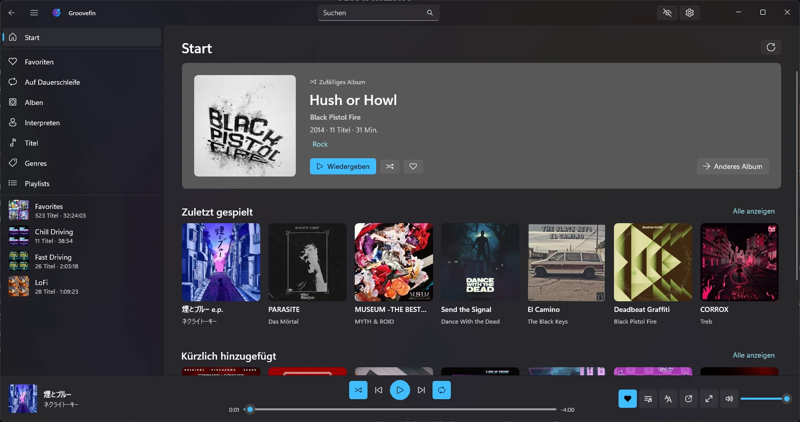

# Groovefin

A native Jellyfin music player for Windows 11, built with C#, .NET 10 and WinUI 3.

[](https://github.com/sysmike/groovefin/actions/workflows/ci.yml)
[](https://github.com/sysmike/groovefin/actions/workflows/codeql.yml)
[](LICENSE)



## Features

**Library**
- Start page with recommendations
- Albums, artists, genres, playlists and folders, with sorting and filters
- Search
- Favourites, playlists and instant mixes

**Playback**
- Gapless playback and crossfade
- Even volume across songs and albums
- Stream quality setting for slow connections
- A 10-band equalizer with presets
- Synced lyrics
- Offline mode

**Windows integration**
- Media keys, Windows media controls and taskbar buttons
- Full-screen player and mini player
- Keyboard shortcuts
- Notification icon
- A privacy mode that stops reporting what you play
- A notice when a newer release is out (a daily check with GitHub that you can turn off in Settings → About)

## Install

You need Windows 11 (21H2 or later) and a [Jellyfin](https://jellyfin.org) server. Lyrics need
Jellyfin 10.9 or later.

Download the latest release from the [Releases page](https://github.com/sysmike/groovefin/releases):

<details>
<summary>Unsigned releases and checking a download</summary>

- If a release is marked as unsigned, turn on Developer Mode (Settings → System → For developers) and
  install it in PowerShell with `Add-AppxPackage -AllowUnsigned .\Groovefin_*.msix`, or use the ZIP.
- Check a download against its line in `SHA256SUMS.txt`, or with
  `gh attestation verify <file> --repo sysmike/groovefin`.

</details>

## Getting started

1. Enter your server's address, for example `https://192.168.1.10:8920`.
2. Sign in with your Jellyfin user, or with Quick Connect.

## Build from source

You need Windows 11 and either Visual Studio 2026 (workloads *.NET desktop development*, *WinUI
application development* and *Desktop development with C++*) or the .NET 10 SDK with the Visual C++
build tools. The C++ tools link the equalizer's audio effect (NativeAOT); without them, build with
`-p:GroovefinAudioEffects=false` and the app runs without the equalizer.

```powershell
git clone https://github.com/sysmike/groovefin.git
cd groovefin
dotnet build Groovefin.sln -c Release -p:Platform=x64
dotnet test --solution Groovefin.CrossPlatform.slnf -c Release
```

To run the app, open `Groovefin.sln` in Visual Studio, set `Groovefin.App` as the startup project
and press F5. Use `-p:Platform=ARM64` on ARM PCs.

Groovefin is built with C#, .NET 10 and WinUI 3. The core libraries and their tests also build on
Linux and macOS (`dotnet test --solution Groovefin.CrossPlatform.slnf`).

- [Architecture](docs/architecture.md): projects, layers and conventions.
- [Contributing](docs/contributing.md): issues, branches, commits and the definition of done.
- [CI/CD](docs/ci.md): workflows, releases and signing.

## License

Groovefin is licensed under the [MIT License](LICENSE). The licenses of the components it uses are
listed in the app (Settings → About → Third-party software).

Groovefin is not affiliated with the Jellyfin project. [Feishin](https://github.com/jeffvli/feishin)
(GPL-3.0) is used as a UX reference only; no code or assets are copied from it.
