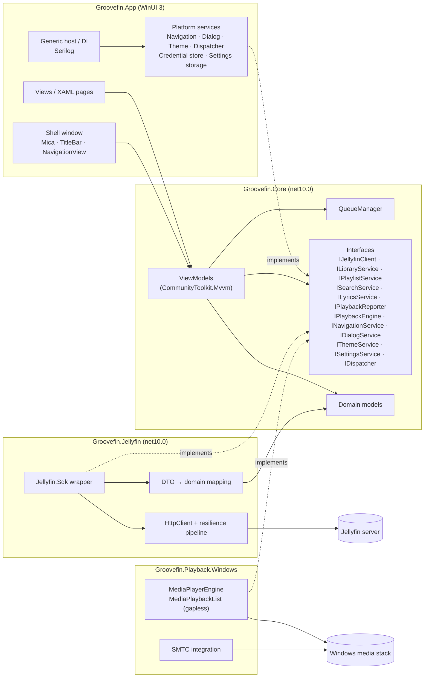
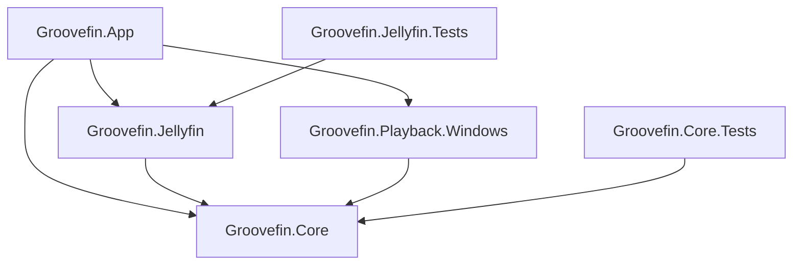

# Architecture

Groovefin is a native Jellyfin music player for Windows 11. It is written in C# on .NET 10 with
WinUI 3 (Windows App SDK). This document describes how the solution is split, which project may
depend on which, and the conventions every feature follows.

## Goals

- **Native first.** Fluent design and stock WinUI 3 controls. No WebView2 for UI.
- **Testable.** All logic that does not need WinUI (domain, ViewModels, queue, API mapping) runs and
  is unit-tested on any OS.
- **Replaceable edges.** The Jellyfin SDK and the Windows media stack sit behind interfaces. This
  makes a libmpv engine or a second server backend possible later.

## Projects

| Project | Target | Responsibility |
|---|---|---|
| `Groovefin.App` | `net10.0-windows10.0.22000.0`, WinUI 3, single-project MSIX | Composition root (generic host + DI), XAML views, styles, `.resw` resources, platform services (navigation, dialogs, theme, dispatcher, credentials, settings storage location). |
| `Groovefin.Core` | `net10.0` | Domain models, service interfaces, ViewModels, `QueueManager`, settings model, messages. **No WinUI or Windows references.** |
| `Groovefin.Jellyfin` | `net10.0` | Implements the Core API interfaces with `Jellyfin.Sdk`: authentication, DTO→domain mapping, stream URLs, image URLs, playback reporting, resilient HTTP pipeline. |
| `Groovefin.Playback.Windows` | `net10.0-windows10.0.22000.0` | `IPlaybackEngine` implementation using `Windows.Media.Playback.MediaPlayer` + `MediaPlaybackList`. System Media Transport Controls. |
| `Groovefin.Core.Tests` | `net10.0` | Unit tests for Core (ViewModels, queue, parsers). |
| `Groovefin.Jellyfin.Tests` | `net10.0` | Unit tests for the Jellyfin layer against WireMock.Net fakes. |

## Component diagram

## Dependency rules

1. `Groovefin.Core` references no other Groovefin project and no WinUI / WinRT API.
2. `Groovefin.Jellyfin` and `Groovefin.Playback.Windows` reference only `Groovefin.Core`. They never
   reference each other.
3. Only `Groovefin.App` references everything. It is the only place that registers implementations
   in DI.
4. ViewModels never use `Jellyfin.Sdk` types. The Jellyfin layer maps DTOs to Core domain models
   (`Album`, `Artist`, `Track`, `Playlist`, ...) before they leave the project.
5. Views bind to ViewModels with `x:Bind`. Views contain no business logic. Code-behind is limited to
   pure view concerns (animations, focus, drag visuals).

## Key abstractions

| Interface | Lives in | Implemented in | Purpose |
|---|---|---|---|
| `IJellyfinClient` | Core | Jellyfin | Connection, authentication, server info. Entry point to the focused services below. |
| `ILibraryService` | Core | Jellyfin | Albums, artists, tracks, genres, folders, favourites, instant mix. |
| `IPlaylistService` | Core | Jellyfin | Playlist CRUD and track editing. |
| `ISearchService` | Core | Jellyfin | Grouped search and suggestions. |
| `ILyricsService` | Core | Jellyfin | Lyrics (synced LRC and plain text). |
| `IPlaybackReporter` | Core | Jellyfin | `/Sessions/Playing`, `/Progress`, `/Stopped`. |
| `IPlaybackEngine` | Core | Playback.Windows | Load, play, pause, seek, volume. Events for position, state and track changes. |
| `QueueManager` | Core | — (concrete, pure) | Queue order, shuffle with stable original order, repeat modes, history. |
| `IPlayer` | Core | Core (`Player`) | Queue and engine together: play/shuffle/queue tracks, transport, auto-advance, skipping failed tracks. Stream URLs come from `IStreamUrlProvider` with the streaming settings for the active server. |
| `ISystemMediaControls` | Core | Playback.Windows | Media keys and the Windows media flyout (SMTC of the engine's `MediaPlayer`, its command manager off). `SystemMediaControlsSync` (Core) shows the playing track, status and timeline and sends the buttons to `IPlayer`. |
| `IStreamUrlProvider` | Core | Jellyfin | `/Audio/{id}/universal` URLs (direct play or transcode, bitrate limit). |
| `INavigationService` | Core | App | Navigate by ViewModel type + parameter, back stack. |
| `IDialogService` | Core | App | Content dialogs, confirmations, pickers. |
| `IThemeService` | Core | App | Light / dark / system theme, density. |
| `ISettingsService` | Core | Core + App storage location | Strongly typed settings persisted as JSON. |
| `IDispatcher` | Core | App | Marshal work to the UI thread. The only way code outside views touches the UI thread. |
| `ICredentialStore` | Core | App | Access tokens in `PasswordVault`. |

## Jellyfin layer

- `JellyfinClient` owns the active `ServerConnection` (server URL, user ID, access token) and one SDK
  client (`JellyfinApiClient`) per connection. `Connect` replaces it; the focused services always use
  the current one.
- Every request carries `Authorization: MediaBrowser Client="Groovefin", Device=…, DeviceId=…,
  Version=…[, Token=…]`. The SDK's own header drops the client fields once a token is set, so
  Groovefin uses its own `IAuthenticationProvider`. The device ID is stable per Windows user and
  machine (`EasClientDeviceInformation`).
- DTOs are mapped to Core models in `Mapping/`. IDs use Jellyfin's 32-digit hex form.
- SDK (`ApiException`) and transport errors become `JellyfinException` with the HTTP status code
  (`null` when the server was unreachable). Callers never see SDK types.
- The focused interfaces (`IPlaylistService`, `ISearchService`, `ILyricsService`,
  `IPlaybackReporter`) are added with the features that need them (#36, #41, #44, #31).

## Conventions

### Threading

- All I/O is `async` and takes a `CancellationToken`. Nothing blocks the UI thread.
- ViewModel properties are changed on the UI thread. Background work (engine events, network
  callbacks) uses `IDispatcher.EnqueueAsync`.
- Page ViewModels cancel their outstanding loads when the user navigates away. Cached pages
  (`NavigationCacheMode`, e.g. Albums) are the exception: they keep their ViewModel, list and scroll
  position for the next visit.

### Networking and errors

- The Jellyfin layer uses `IHttpClientFactory` with the `Microsoft.Extensions.Http.Resilience`
  standard pipeline: up to 3 retries with exponential back-off and jitter for transient failures
  (network errors, timeouts, 408, 429, 5xx) of **safe** methods only, 15 s per attempt, 45 s per
  request, and a circuit breaker. 4xx such as 401 are never retried.
- Services throw only `JellyfinException` (HTTP status, or `null` when the server was unreachable or
  timed out). Caller cancellation stays an `OperationCanceledException` and is not an error.
- Failures are never silent. Code that catches an exception and does not rethrow calls
  `IErrorReporter.Report(exception, Operations.X)`. It logs the details and shows a localized
  InfoBar in the shell through `INotificationService` (at most 3, duplicates dropped).
- Unhandled XAML and unobserved task exceptions are reported the same way and the app keeps running.

### Logging

- `Microsoft.Extensions.Logging` everywhere, Serilog as the provider.
- Rolling log files in local app data (`Logs\groovefin-.log`), retained for 7 days.
- Never log access tokens, passwords or full authorization headers.

### Settings and secrets

- Settings: JSON in `ApplicationData.LocalFolder` (packaged) or `%LOCALAPPDATA%\Groovefin`
  (unpackaged).
- Access tokens: `Windows.Security.Credentials.PasswordVault`. Passwords are never stored.

### MVVM

- `CommunityToolkit.Mvvm` source generators (`[ObservableProperty]`, `[RelayCommand]`).
- Cross-ViewModel communication via `IMessenger` (e.g. `FavouriteChangedMessage`,
  `NowPlayingChangedMessage`).

### UI

- Theme resources and the system accent colour only. No hard-coded colours or fonts.
- Virtualized lists everywhere (`ItemsView` / `ItemsRepeater`, incremental loading).
- Every user-visible string comes from `.resw` (`en-US`, `de-DE`).
- Every custom control sets `AutomationProperties`.
- Animations are subtle and native (connected animation for album covers) and are skipped when the
  Windows "Animation effects" setting is off.

### TODOs

Every `TODO` references a GitHub issue: `// TODO(#42): handle transcoding fallback`.
