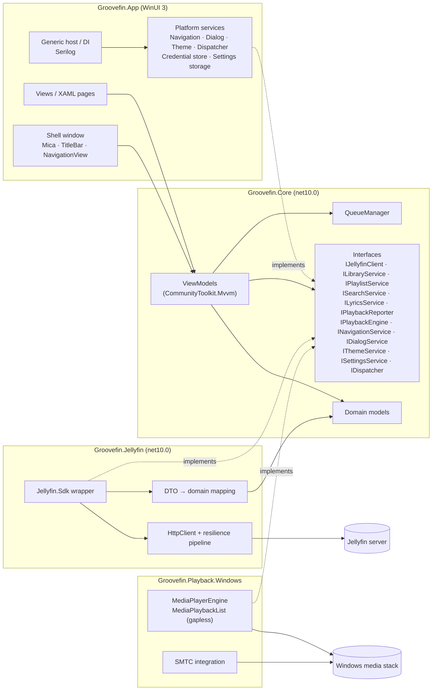
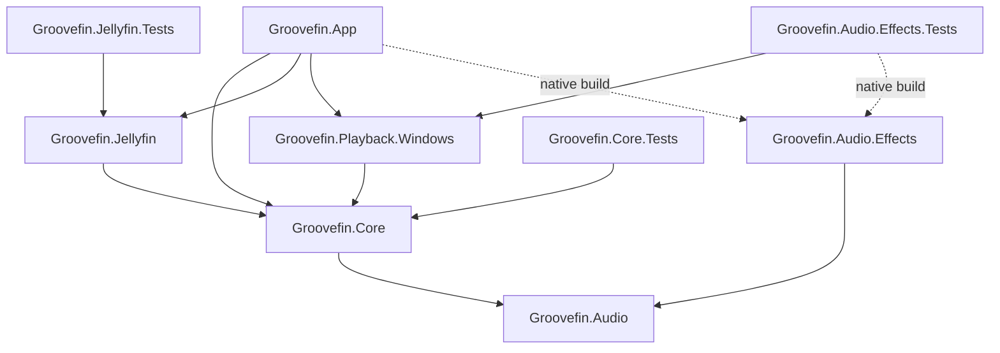

# Architecture

Groovefin is a native Jellyfin music player for Windows 11. It is written in C# on .NET 10 with
WinUI 3 (Windows App SDK). This document describes how the solution is split, which project may
depend on which, and the conventions every feature follows.

## Goals

- **Native first.** Fluent design and stock WinUI 3 controls. No WebView2 for UI.
- **Testable.** All logic that does not need WinUI (domain, ViewModels, queue, API mapping) runs and
  is unit-tested on any OS.
- **Replaceable edges.** The Jellyfin SDK and the Windows media stack sit behind interfaces. This
  makes a libmpv engine or a second server backend possible later.

## Projects

| Project | Target | Responsibility |
|---|---|---|
| `Groovefin.App` | `net10.0-windows10.0.22000.0`, WinUI 3, single-project MSIX | Composition root (generic host + DI), XAML views, styles, `.resw` resources, platform services (navigation, dialogs, theme, dispatcher, credentials, settings storage location). |
| `Groovefin.Core` | `net10.0` | Domain models, service interfaces, ViewModels, `QueueManager`, settings model, messages. **No WinUI or Windows references.** |
| `Groovefin.Audio` | `net10.0` | The equalizer's signal processing (peaking filters, parameters), without dependencies. Used by Core and by the audio effect. |
| `Groovefin.Audio.Effects` | `net10.0-windows10.0.26100.0` (minimum 10.0.22000), C#/WinRT component, NativeAOT | The equalizer as a Media Foundation audio effect (`IBasicAudioEffect`). Published as a native DLL next to `Groovefin.exe`; see [Audio effects](#audio-effects). |
| `Groovefin.Jellyfin` | `net10.0` | Implements the Core API interfaces with `Jellyfin.Sdk`: authentication, DTO→domain mapping, stream URLs, image URLs, playback reporting, resilient HTTP pipeline. |
| `Groovefin.Playback.Windows` | `net10.0-windows10.0.22000.0` | `IPlaybackEngine` implementation using `Windows.Media.Playback.MediaPlayer` + `MediaPlaybackList`. System Media Transport Controls. |
| `Groovefin.Core.Tests` | `net10.0` | Unit tests for Core (ViewModels, queue, parsers). |
| `Groovefin.Jellyfin.Tests` | `net10.0` | Unit tests for the Jellyfin layer against WireMock.Net fakes. |
| `Groovefin.Audio.Effects.Tests` | `net10.0-windows10.0.26100.0` | Windows only: sends a tone through the published NativeAOT effect with Media Foundation's transcoder and measures the level. |

## Component diagram

## Dependency rules

1. `Groovefin.Core` references no other Groovefin project but `Groovefin.Audio` (plain signal processing,
   no dependencies), and no WinUI / WinRT API.
2. `Groovefin.Jellyfin` and `Groovefin.Playback.Windows` reference only `Groovefin.Core`. They never
   reference each other.
3. Only `Groovefin.App` references everything. It is the only place that registers implementations
   in DI.
4. ViewModels never use `Jellyfin.Sdk` types. The Jellyfin layer maps DTOs to Core domain models
   (`Album`, `Artist`, `Track`, `Playlist`, ...) before they leave the project.
5. Views bind to ViewModels with `x:Bind`. Views contain no business logic. Code-behind is limited to
   pure view concerns (animations, focus, drag visuals).
6. Every NuGet package the app ships has a license notice in `ThirdPartyNotices` (Core), which the
   About section of Settings lists. `ThirdPartyNoticesTests` checks the list against
   `src/Groovefin.App/packages.lock.json`, so adding a dependency without its notice fails CI.

## Key abstractions

| Interface | Lives in | Implemented in | Purpose |
|---|---|---|---|
| `IJellyfinClient` | Core | Jellyfin | Connection, authentication, server info. Entry point to the focused services below. |
| `ILibraryService` | Core | Jellyfin | Albums, artists, tracks, genres, folders, favourites, instant mix. Jellyfin keeps play dates and counts on songs, not albums, so albums by last play, by play count and "played only" are worked out from the played songs (up to 5,000, newest or most played first): an album counts as played when one of its songs was (#369), and its play count is the sum of its songs' (#372). Artists by play count likewise: a song counts for its album artists, or when every artist is listed, for its track artists (#374). |
| `IPlaylistService` | Core | Jellyfin | Playlist CRUD and track editing. |
| `ISearchService` | Core | Jellyfin | Grouped search and suggestions. |
| `ILyricsService` | Core | Jellyfin | Lyrics (synced LRC and plain text). |
| `IPlaybackReporter` | Core | Jellyfin | `/Sessions/Playing`, `/Progress`, `/Stopped`; `MarkPlayedAsync` (`/UserPlayedItems/{id}?datePlayed=`) for plays from offline (#339): `PlaybackReporting` raises `StartUnsent` for a start the server could not be reached for, and `PlayHistory` keeps it in the user's history file and sends it once the server can be reached again, as a start Groovefin reported. |
| `IMixEditor` | Core | App (`MixEditorDialog`) | Rule-based mixes (#401): `MixRules` (genre, years, favourites, plays, last played, date added, order, size) are kept per server and user in the settings (`MixStore`). `MixBuilder` asks the server for songs by genre, years and favourites in the mix's order and checks plays, the last play and the date added itself, page by page, until the mix is full or 5,000 songs were looked at. The editor is a dialog over `MixEditorViewModel`. |
| `IPlaybackEngine` | Core | Playback.Windows | Load, play, pause, seek, volume. Queues the next source (`SetNext`) and moves on to it without a gap (`MediaPlaybackList` with the current and the next item). Optional crossfade (`Crossfade`): `PlaybackEngineBase` starts the next source on a second player near the end and fades the two (equal power); tracks of the same album stay gapless. Events for position, state and track changes. |
| `QueueManager` | Core | — (concrete, pure) | Queue order, shuffle with stable original order, repeat modes, history. Shuffle spreads artists, and an artist's albums, apart instead of plain random; Shuffle albums plays whole albums in a random order (`Shuffling`, #403). |
| `IPlayer` | Core | Core (`Player`) | Queue and engine together: play/shuffle/queue tracks, transport, auto-advance, skipping failed tracks, keeping the engine's next source on the queue's next entry (gapless). Stream URLs come from `IStreamUrlProvider` with the streaming settings for the active server. |
| `IAudioOutput` | Core | Playback.Windows (`MediaPlayerEngine`) | The output device (#389): `AudioOutputSync` passes Settings → Playback → Output device to the engine, which sets `MediaPlayer.AudioDevice` on every deck (so crossfades use it too). A device watcher follows the chosen device: while it is not connected the Windows default plays, and it takes over again when it is back. |
| `IPlayer` | Core | Core (`Player`) | Queue and engine together: play/shuffle/queue tracks, transport, auto-advance, skipping failed tracks (a stream the network broke is first tried again where it stopped, after 1, 2, 4, 8 and 15 seconds and at once when the network is back; `StreamFailures` tells network failures from files that can't play, #385), keeping the engine's next source on the queue's next entry (gapless). Stream URLs come from `IStreamUrlProvider` with the streaming settings for the active server. |
| `ISystemMediaControls` | Core | Playback.Windows | Media keys and the Windows media flyout (SMTC of the engine's `MediaPlayer`, its command manager off). `SystemMediaControlsSync` (Core) shows the playing track, status and timeline and sends the buttons to `IPlayer`. |
| `IJumpList` | Core | App (`WindowsJumpList`) | The taskbar button's and Start menu entry's jump list (#406): Play or pause, Next track and Shuffle all songs, and the favourite playlists (`JumpListSync`). The MSIX build uses the WinRT jump list, the unpackaged build the shell's `ICustomDestinationList`. Entries start `Groovefin.exe` with arguments (`JumpListCommand`); Groovefin runs once (`Program.cs`, `AppInstance`), so a start while it runs goes to the running app, which runs the command (`JumpListActions`) or, for a plain start, comes to the front. |
| `IAudioEqualizer` | Core | Playback.Windows | The equalizer in the audio path: whether the effect could be added, and its parameters. `EqualizerSync` (Core) passes the settings on. |
| `IStreamUrlProvider` | Core | Jellyfin | `/Audio/{id}/universal` URLs (direct play or transcode, bitrate limit). |
| `IDownloadSource` | Core | Jellyfin | A song's file for offline downloads (#327): the original (`/Audio/{id}/stream?static=true`, else `/Items/{id}/Download`), resumed with `Range`, or AAC at a bitrate. Its own HTTP client without the 45-second limit. |
| `DownloadManager` | Core | — (concrete) | Keeps the collections that are on in Settings → Downloads on disk (favourite songs, albums and artists, playlists): reads the wanted songs, downloads the missing ones (two at a time, to `.part` files), deletes the unneeded ones. A song whose file changed on the server (container and size, `ILibraryService.GetTrackFilesAsync`) downloads again. An original in a container Windows cannot play (not in `StreamUrlBuilder.DirectPlayContainers`) comes as AAC at 320 kbps, and an AAC download that is an MP4 file is named `.m4a` (#362). A downloaded FLAC file whose audio starts more than 1 MB in is rewritten without its picture and padding blocks (`FlacMetadata`, #365): Windows cannot open a file whose audio starts 8 MB in, behind a large cover; the same sizes estimate a collection before it is turned on (`EstimateAsync`, a question above 1 GB). A folder per server and user with its index (`IDownloadStore`, `downloads.json`); the folders of a server no longer in the list are deleted. They are in local app data, or in a `Groovefin Downloads` folder in the folder chosen in Settings (#399): changing it moves the files (`MoveAsync`: on the same drive file by file, else copied, with progress; a failure or Cancel puts everything back), and while that folder's drive is not there nothing downloads or is deleted (`FolderMissing`). The Downloads page (#388) lists each download from the index with its state and size (`GetItems`), retries one's failed songs (`RetryAsync`), and removes one: the favourite songs turn their switch off, a playlist, album or artist goes into `DownloadSettings.Removed` (per server and user) and is left out of the wanted songs until Download again (`Restore`). |
| `INetworkStatus` | Core | App | Online and metered, from Windows' connection profiles. |
| `OfflineLibraryService`, `OfflinePlaylistService` | Core | — (decorators) | The pages' `ILibraryService` and `IPlaylistService` (#335): the server's, but when it cannot be reached (or the PC has no network) Favourites, the playlists and the pages of albums and artists come from the download index (`OfflineCatalog`), and `OfflineMode` shows a notice until the server answers again. Every other query and error passes through. `AppHost` wraps the Jellyfin registrations; `DownloadManager` gets the unwrapped ones (`ServerServices`). |
| `IImageFallback` | Core | Core (`DownloadManager`) | The covers kept with the downloads (one per album, artist and playlist, 512 px): `DiskImageCache` shows them when the server cannot give an image. |
| `IOfflineLibrary` | Core | Core (`DownloadManager`) | The marks (#337): `IsDownloaded` per song, `IsComplete` per favourite album or artist and playlist, and `Changed`; `CurrentTrack` marks every watched track list with them, as it marks the playing track. A song's downloaded file (#333). `Player` plays it instead of a stream, also online and without a server connection (a `file:///` URI, no `UrlAt`); offline it skips the queue's songs without one. |
| `IPlayLog` | Core | Core (`PlayHistory`) | The signed-in user's plays (#382), kept for 400 days: the statistics, and the home page's rows from the history (#394): a random artist from the plays, and the albums played most this week last year. The home page's rows are chosen in Settings (`AppearanceSettings.HomeRows`, read through `HomeLayout`); "Not played in a year" comes from the server's play dates (`AlbumQuery.PlayedBefore`). |
| `INavigationService` | Core | App | Navigate by ViewModel type + parameter, back stack. |
| `IDialogService` | Core | App | Content dialogs, confirmations, pickers. |
| `IFolderPicker` | Core | App (`WindowsFolderPicker`) | The Windows folder picker, for the download folder (#399). |
| `IThemeService` | Core | App | Light / dark / system theme, density. |
| `ISettingsService` | Core | Core + App storage location | Strongly typed settings persisted as JSON. |
| `IDispatcher` | Core | App | Marshal work to the UI thread. The only way code outside views touches the UI thread. |
| `ICredentialStore` | Core | App | Access tokens in `PasswordVault`. |

## Audio effects

`MediaPlayer` takes audio effects only as registered WinRT classes (`AddAudioEffect(classId, …)`):
Media Foundation creates them with `RoActivateInstance`. So the equalizer runs as follows:

- `Groovefin.Audio.Effects` implements `IBasicAudioEffect` with C#/WinRT authoring. `Groovefin.App`
  publishes it with NativeAOT for its runtime identifier (`PublishAudioEffects` target), and ships the
  native `Groovefin.Audio.Effects.dll`, which exports `DllGetActivationFactory`. The target lives in
  `PublishAudioEffects.targets`, which the effect's tests import too. NativeAOT is used instead
  of C#/WinRT's `WinRT.Host.dll` because that host needs an installed .NET runtime, while the unpackaged
  app is self-contained.
- `Package.appxmanifest` (MSIX) and `app.manifest` (unpackaged, registration-free WinRT) register the
  class `Groovefin.Audio.Effects.EqualizerEffect` in that DLL.
- `MediaPlayerEngine` asks Windows for the class's activation factory first, logs the result
  ("Equalizer effect is available"), and only then adds it, as optional. Without it, Settings hides the
  equalizer and playback works as before. The CI smoke test fails if the log says otherwise.
- The effect and the app run different .NET runtimes in one process. The app passes the parameters as
  one string (`EqualizerParameters.Format`) to a function the DLL exports
  (`EqualizerEffectContract.SetParametersExport`, called by `EqualizerEffectLibrary`); every effect in the
  process uses what was set last, from its next buffer on. The effect's property set is not used: Media
  Foundation did not pass later changes to it on to the effect (#169).
- The effect cannot log and never lets an error stop playback. It counts the buffers it received,
  equalized and left alone after an error (`GetStatusExport`, `EqualizerEffectStatus`); the engine logs new
  errors at the start of each track.
- The effect also takes the pop out of a seek (#283), with the equalizer on or off: after a seek far ahead,
  playback stops until the new part has arrived and restarts at full level, and the decoder's first frame
  there can be broken. When Media Foundation flushes the effect for a seek (`DiscardQueuedFrames`), the
  next 40 ms stay silent, which covers an MP3 or AAC frame, and the next 20 ms rise to full level
  (`SeekFade`). A transcode restarted at a seek target is a new stream, which the effect cannot tell from
  the next track: the engine calls `FadeInNextStreamExport` first, and the next stream an effect starts on
  within 5 seconds fades in the same way.
- The filter and fade maths live in `Groovefin.Audio` and are unit-tested on every platform. The effect project
  itself builds only on Windows (`cswinrt.exe`). `Groovefin.Audio.Effects.Tests` runs the built DLL in CI:
  Media Foundation's transcoder creates the effect like MediaPlayer does, but needs no sound card. A boost
  of the 1 kHz band must make a 1 kHz tone about 12 dB louder.

## Jellyfin layer

- `JellyfinClient` owns the active `ServerConnection` (server URL, user ID, access token) and one SDK
  client (`JellyfinApiClient`) per connection. `Connect` replaces it; the focused services always use
  the current one.
- Every request carries `Authorization: MediaBrowser Client="Groovefin", Device=…, DeviceId=…,
  Version=…[, Token=…]`. The SDK's own header drops the client fields once a token is set, so
  Groovefin uses its own `IAuthenticationProvider`. The device ID is stable per Windows user and
  machine (`EasClientDeviceInformation`).
- DTOs are mapped to Core models in `Mapping/`. IDs use Jellyfin's 32-digit hex form.
- SDK (`ApiException`) and transport errors become `JellyfinException` with the HTTP status code
  (`null` when the server was unreachable). Callers never see SDK types.
- The focused interfaces (`IPlaylistService`, `ISearchService`, `ILyricsService`,
  `IPlaybackReporter`) are added with the features that need them (#36, #41, #44, #31).

## Conventions

### Threading

- All I/O is `async` and takes a `CancellationToken`. Nothing blocks the UI thread.
- ViewModel properties are changed on the UI thread. Background work (engine events, network
  callbacks) uses `IDispatcher.EnqueueAsync`.
- Page ViewModels cancel their outstanding loads when the user navigates away. Cached pages
  (`NavigationCacheMode`, e.g. Albums) are the exception: they keep their ViewModel, list and scroll
  position for the next visit.

### Networking and errors

- The Jellyfin layer uses `IHttpClientFactory` with the `Microsoft.Extensions.Http.Resilience`
  standard pipeline: up to 3 retries with exponential back-off and jitter for transient failures
  (network errors, timeouts, 408, 429, 5xx) of **safe** methods only, 15 s per attempt, 45 s per
  request, and a circuit breaker. 4xx such as 401 are never retried.
- Each retry calls `RequestAttempts.Retrying` (Core). A caller that wants to show progress watches its own
  requests with `RequestAttempts.Watch`: adding a server says "Trying again (attempt 2)…" and can be
  cancelled (#392).
- Services throw only `JellyfinException` (HTTP status, or `null` when the server was unreachable or
  timed out). Caller cancellation stays an `OperationCanceledException` and is not an error.
- Failures are never silent. Code that catches an exception and does not rethrow calls
  `IErrorReporter.Report(exception, Operations.X)`. It logs the details and shows a localized
  InfoBar in the shell through `INotificationService` (at most 3, duplicates dropped).
- Unhandled XAML and unobserved task exceptions are reported the same way and the app keeps running.

### Logging

- `Microsoft.Extensions.Logging` everywhere, Serilog as the provider.
- Rolling log files in local app data (`Logs\groovefin-.log`), retained for 7 days.
- Never log access tokens, passwords or full authorization headers.

### Settings and secrets

- Settings: JSON in `ApplicationData.LocalFolder` (packaged) or `%LOCALAPPDATA%\Groovefin`
  (unpackaged).
- Access tokens: `Windows.Security.Credentials.PasswordVault`. Passwords are never stored.
- App identity: the unpackaged app has no package identity, so on start it sets its own AppUserModelID (`Groovefin`)
  and writes a per-user Start menu shortcut with the same ID (`AppIdentity`, #271). The shell resolves
  that ID to the shortcut's name and icon, so the media flyout, which names a session by its app, shows
  "Groovefin" instead of "Unknown application". The MSIX build uses its package identity instead.

### MVVM

- `CommunityToolkit.Mvvm` source generators (`[ObservableProperty]`, `[RelayCommand]`).
- Cross-ViewModel communication via `IMessenger` (e.g. `FavouriteChangedMessage`,
  `NowPlayingChangedMessage`).

### UI

- Theme resources and the system accent colour only. No hard-coded colours or fonts.
- Virtualized lists everywhere (`ItemsView` / `ItemsRepeater`, incremental loading).
- Every user-visible string comes from `.resw` (`en-US`, `de-DE`).
  `ResourceFileTests` (Core tests, runs in CI) fails when the two languages differ in keys or
  `{0}` placeholders, when an `x:Uid` or a key named in code has no string, or when a string is unused.
  Keys are `Area_Name` (code) or `XUid.Property` (XAML). Numbers and dates are formatted with
  `CultureInfo.CurrentCulture`.
- Every custom control sets `AutomationProperties`.
- Loading rings are named for what they wait for (`LoadingRing`, `SignInProgressRing`, …); decorative
  elements such as images next to their name and `SiteIcon` use `AccessibilityView="Raw"`. The smoke test
  checks every page with the Axe.Windows rules and walks the tab order (see docs/ci.md).
- The page and the now playing bar are landmarks (`LandmarkGrid`: `Main`, and `Custom` "Player"), so Narrator
  can jump between them; a plain `Grid` has no automation element and would drop their names.
- Access keys (Alt) for the navigation, the search box and the now playing bar come from `.resw`
  (`XUid.AccessKey`), because the letters follow the localized labels. They share the window's
  scope, so a letter is used once per language; `ResourceFileTests` checks it.
- Pages have no access keys of their own (decided in #51). With one window-wide scope, every page's
  buttons would compete for the same 26 letters with the navigation and the bar, and need two-letter
  keys or nested scopes that are harder to learn. Page controls are reached with Tab instead, in
  reading order (the smoke test walks it), and the common actions have keyboard shortcuts (Settings →
  Keyboard shortcuts).
- Animations are subtle and native (connected animation for album covers) and are skipped when the
  Windows "Animation effects" setting is off.

### TODOs

Every `TODO` references a GitHub issue: `// TODO(#42): handle transcoding fallback`.
